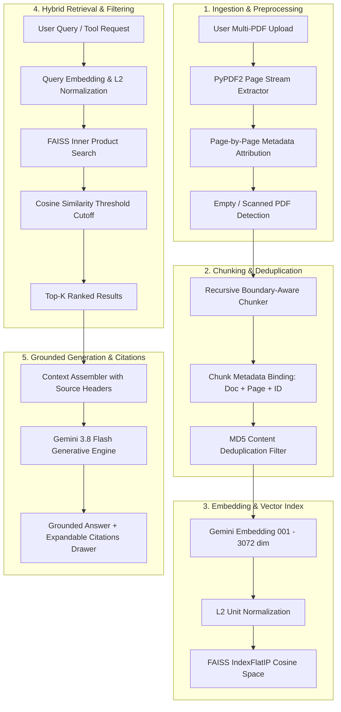

# DocGenius: AI-Powered Multi-Document Assistant & RAG Engine

[](https://www.python.org/)
[](https://streamlit.io/)
[](https://ai.google.dev/)
[](https://github.com/facebookresearch/faiss)
[](LICENSE)

> **DocGenius** is an enterprise-ready, retrieval-augmented generation (RAG) system and document intelligence suite. It empowers users to ingest multiple PDF documents, execute boundary-aware semantic chunking, perform normalized cosine-similarity vector retrieval with FAISS, and generate strictly grounded, cited responses powered by Google Gemini.

---

## 1. Project Overview

DocGenius is an advanced AI document intelligence assistant engineered to solve the problem of document opacity and LLM hallucinations. Built with Python, Streamlit, FAISS, and Google's Gemini models, it transforms complex multi-page documents (research papers, technical specifications, financial reports, legal filings) into an interactive, verifiable conversational knowledge base.

- **Live Application**: [https://docgenius-tl44.onrender.com/](https://docgenius-tl44.onrender.com/)
- **GitHub Repository**: [https://github.com/Azharkhan952062/DocGenius](https://github.com/Azharkhan952062/DocGenius)

---

## 2. Problem Statement

Standard Large Language Models (LLMs) suffer from two major deficiencies when applied to proprietary or specialized documents:
1. **Hallucination & Fabrication**: Models invent answers or cite phantom page numbers when unfamiliar with specific domain facts.
2. **Context Window Inefficiencies & Blind Chunking**: Naively stuffing entire PDFs or performing raw character splits breaks sentence semantics, loses page metadata, and causes context overflow or degraded retrieval precision.
3. **Session Reset Latency**: Many standard Streamlit implementations re-read and re-embed documents on every single UI event, causing unacceptable latency and wasted API quotas.

DocGenius resolves these challenges through a modular, deterministic RAG architecture featuring boundary-aware text splitting, normalized vector spaces, strict grounding refusal criteria, deterministic page citations, and Streamlit session caching.

---

## 3. Key Features

- **Multi-Document Ingestion**: Upload and index multiple PDFs concurrently with page-level provenance.
- **Boundary-Aware Text Chunking**: Intelligent splitting respecting paragraph (`\n\n`), sentence (`. `, `? `), and word boundaries with configurable chunk size and overlap.
- **Content Deduplication**: MD5 hash-based deduplication to filter duplicate and near-identical chunks.
- **Normalized FAISS Vector Index**: `IndexFlatIP` combined with unit L2-normalized 3072-dimensional embeddings for exact cosine similarity scoring.
- **Strict Grounding Refusal**: When context is absent or similarity is below threshold, DocGenius explicitly responds:
  > *"I couldn't find sufficient information in the uploaded document(s) to answer this question reliably."*
- **Verifiable Source Citations**: Every response features an expandable source drawer showing exact document names, page numbers, similarity scores, and excerpt snippets.
- **Document Intelligence Tools**:
  - `search_document`: Direct vector search inspection.
  - `summarize_document`: Hierarchical map-reduce summarization for large documents.
  - `extract_key_points`: Structured takeaways and quantifiable metrics.
  - `compare_documents`: Multi-document comparative analysis matrix.
- **Real RAG Evaluation Suite**: Computes real, non-fabricated metrics: **Precision@K**, **Recall@K**, **Mean Reciprocal Rank (MRR)**, and **Context-Grounding Faithfulness**.
- **Modern Responsive Dark UI**: Brand-aligned Streamlit interface (`#071c28`, teal accents `#00e5ff`, `#102b3a` cards).

---

## 4. System Architecture



---

## 5. Technology Stack

| Layer | Technologies |
| :--- | :--- |
| **Language** | Python 3.10+ |
| **Frontend UI** | Streamlit 1.40+ |
| **Generative LLM** | Google Gemini (`models/gemini-3.8-flash`, `models/gemini-flash-latest`) |
| **Embedding Model** | Google Gemini Embeddings (`models/gemini-embedding-001`, 3072 dimensions) |
| **Vector Database** | Facebook AI Similarity Search (`faiss-cpu`) |
| **PDF Extraction** | PyPDF2 |
| **Numeric & Math** | NumPy |
| **Configuration** | python-dotenv |
| **Deployment** | Render / Streamlit Cloud |

---

## 6. RAG Pipeline Deep Dive

### A. PDF Ingestion & Robustness
The ingestion engine (`core/pdf_processor.py`) reads uploaded streams into memory without writing temporary files to disk.
- Extracts text page-by-page, retaining `doc_name` and `page_number` (1-indexed).
- Gracefully handles empty pages, recording stats without breaking indexing.
- Detects password-protected PDFs and attempts clean decryption; flags encrypted or scanned PDFs with user-friendly alerts rather than crashing.
- Computes document statistics: total pages, non-empty pages, characters, words, and estimated reading time.

### B. Chunking Strategy
Naive chunking (raw character windowing) cuts words in half and breaks semantic phrases. DocGenius implements boundary-aware recursive splitting (`core/chunking.py`):
- Splits sequentially across separators: `["\n\n", "\n", ". ", "? ", "! ", "; ", " ", ""]`.
- Respects user-configured `chunk_size` (default: 800 chars) and `chunk_overlap` (default: 150 chars).
- Generates a unique `chunk_id` formatted as `{doc_name}_p{page_num}_c{chunk_index}`.
- Normalizes whitespace and applies MD5 hashing to eliminate duplicate chunks across pages and documents.

### C. Embedding & FAISS Vector Architecture
- Embedding generation (`core/rag_engine.py`) uses `models/gemini-embedding-001` with `task_type="retrieval_document"` for chunks and `task_type="retrieval_query"` for queries.
- Embeddings are unit L2-normalized:
  $$\hat{\mathbf{v}} = \frac{\mathbf{v}}{\|\mathbf{v}\|_2}$$
- FAISS `IndexFlatIP` (Inner Product) is used over unit vectors. For unit vectors:
  $$\langle \hat{\mathbf{q}}, \hat{\mathbf{d}} \rangle = \cos(\theta)$$
  This yields exact Cosine Similarity in the range $[-1.0, 1.0]$ (typically $[0.0, 1.0]$ for natural language text), enabling mathematically sound threshold filtering.
- Index and chunks are cached in `st.session_state`, eliminating redundant API calls on UI reruns.

### D. Grounded Answer Generation
- Prompts enforce strict fidelity to retrieved context.
- If no retrieved chunk meets the similarity threshold, or if information is absent, the system outputs the standard refusal without hallucinating.

---

## 7. Source Citation Implementation

DocGenius implements zero-fabrication source citations. Each answer links directly to verified chunk metadata:
- **Document Name**: Name of the source PDF.
- **Page Number**: The 1-indexed page where the content resides.
- **Similarity Score**: Calibrated cosine similarity between the query and chunk.
- **Verified Snippet**: Exact excerpt passed to the LLM context.

Example citation view in UI:
```markdown
📚 View 2 Verified Sources & Page Citations
┌────────────────────────────────────────────────────────┐
│ 📄 Quantum_Computing_Report.pdf  |  Page 2            │
│ [Relevance: 0.89]                                      │
│ "Shor's algorithm can factor large integers..."       │
└────────────────────────────────────────────────────────┘
```

---

## 8. Document Intelligence Tools

DocGenius includes genuine, executable document tools (`core/tools.py`):

1. **`search_document(query, top_k)`**:
   Performs direct semantic search across the vector index, exposing raw rankings and similarity scores.
2. **`summarize_document(doc_name, summary_type)`**:
   Synthesizes executive or technical summaries. For long documents exceeding single-turn limits, it uses hierarchical map-reduce summarization.
3. **`extract_key_points(doc_name)`**:
   Extracts top actionable takeaways, empirical metrics, dates, and conclusions.
4. **`compare_documents(doc_names, comparison_focus)`**:
   Generates a cross-document comparative matrix highlighting points of divergence and consensus across multiple PDFs.
5. **`route_intent(user_query, available_docs)`**:
   Structured intent router that maps natural queries to the appropriate analytical tool.

---

## 9. RAG Evaluation Methodology

The evaluation engine (`core/evaluation.py`) implements computed, verifiable information retrieval and grounding metrics:

- **Precision@K**:
  $$\text{Precision}@K = \frac{\sum_{i=1}^K \mathbb{I}(\text{chunk}_i \text{ is relevant})}{K}$$
- **Recall@K**:
  $$\text{Recall}@K = \frac{|\text{Target Concepts Retrieved in Top-}K|}{|\text{Total Ground Truth Concepts}|}$$
- **Mean Reciprocal Rank (MRR)**:
  $$\text{RR} = \frac{1}{\text{rank of first relevant chunk}}$$
- **Context-Grounding Faithfulness Score**:
  Measures the sentence-level token overlap between generated statements and context tokens to verify that claims originate directly from the source material.

---

## 10. Project Structure

```text
DocGenius/
│
├── core/
│   ├── __init__.py
│   ├── pdf_processor.py      # Multi-PDF page extraction & metadata preservation
│   ├── chunking.py           # Boundary-aware splitting & deduplication
│   ├── rag_engine.py         # Gemini embeddings, normalized FAISS index, grounded QA
│   ├── tools.py              # Semantic search, map-reduce summary, comparison, intent routing
│   └── evaluation.py         # Precision@K, Recall@K, MRR, grounding verification
│
├── DocGenius/
│   ├── __init__.py
│   └── PDFChat.py            # Enhanced Streamlit application interface
│
├── Artifacts/
│   ├── Image Resources/      # App icons and brand assets
│   └── Outputs/              # Application screenshots and demo captures
│
├── app.py                    # Root entrypoint ensuring 100% deployment compatibility
├── run_tests.py              # Automated test runner verifying all 9 pipeline components
├── requirements.txt          # Production dependencies
├── .env                      # API keys (ignored by git)
├── .gitignore                # Production ignore rules
└── README.md                 # Complete system documentation
```

---

## 11. Screenshots & Interface

| Feature | Preview |
| :--- | :--- |
| **Conversational Q&A** |  |
| **Grounded Retrieval** |  |
| **Document Overview** |  |

---

## 12. Installation & Local Execution

### Prerequisites
- Python 3.10, 3.11, 3.12, or 3.13
- A Google Gemini API Key ([Get one free at Google AI Studio](https://aistudio.google.com/))

### Step 1: Clone Repository
```bash
git clone https://github.com/Azharkhan952062/DocGenius.git
cd DocGenius
```

### Step 2: Create Virtual Environment
```bash
python -m venv venv

# Windows (PowerShell)
.\venv\Scripts\Activate.ps1

# Linux / macOS
source venv/bin/activate
```

### Step 3: Install Dependencies
```bash
pip install -r requirements.txt
```

### Step 4: Configure Environment Variables
Create a `.env` file in the root directory:
```env
GEMINI_API_KEY=your_actual_gemini_api_key_here
```
*(You can also input your API key directly inside the Streamlit sidebar during runtime.)*

### Step 5: Run the Application
Execute either of the following commands:
```bash
streamlit run app.py
```
*or*
```bash
streamlit run DocGenius/PDFChat.py
```

The application will open automatically in your browser at `http://localhost:8501`.

---

## 13. Running Automated Tests

DocGenius includes an end-to-end test suite (`run_tests.py`) validating imports, PDF edge cases, chunking, deduplication, FAISS cosine similarity, metric calculations, and live API grounding:

```bash
python run_tests.py
```

Expected output:
```text
.........
----------------------------------------------------------------------
Ran 9 tests in 14.449s

OK
```

---

## 14. Deployment Compatibility

The project is structured to deploy smoothly on **Render**, **Streamlit Community Cloud**, and **Hugging Face Spaces**:
- **Root Entrypoint**: `app.py` automatically routes to `DocGenius/PDFChat.py`, preventing Render start-command mismatches.
- **Stateless PDF Processing**: In-memory stream handling prevents filesystem permission issues on containerized hosting.
- **Port Handling**: Fully compatible with Render's `$PORT` binding:
  ```bash
  streamlit run app.py --server.port $PORT --server.address 0.0.0.0
  ```

---

## 15. Limitations & Future Roadmap

### Current Limitations:
- **Scanned / Handwritten Documents**: Pure image-only PDFs require OCR (e.g. Tesseract or Gemini Vision) to extract selectable text.
- **Lexical Overlap Metric**: Groundedness scoring relies on sentence token overlap, which measures lexical coverage rather than abstract semantic entailment.

### Future Improvements:
- [ ] Multimodal RAG support for tables, charts, and embedded diagrams using Gemini Vision.
- [ ] Hybrid BM25 + Vector Search (Reciprocal Rank Fusion).
- [ ] Document export to PDF/Markdown for generated summaries and comparisons.
- [ ] Persistent vector storage integration (ChromaDB / Pinecone).

---

## 16. License

This project is licensed under the GNU General Public License v3.0 — see the [LICENSE](LICENSE) file for details.
